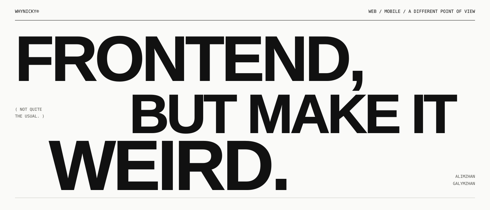
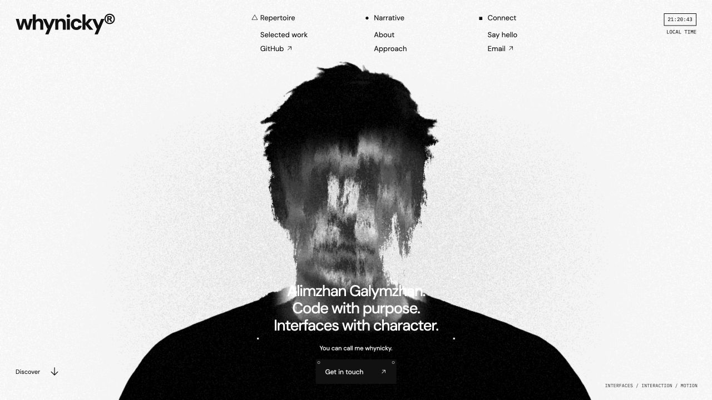

<br>

<p align="center">
  <picture>
    <source media="(prefers-color-scheme: dark)" srcset="./public/images/eye-mark-white.png">
    
  </picture>
</p>

<p align="center">
  <strong>NOT EVERYTHING NEEDS<br>TO LOOK LIKE EVERYTHING ELSE.</strong>
</p>

<p align="center"><sub>A different point of view. By whynicky.</sub></p>

<br>

<p align="center">
  
</p>

<p align="center">
  <a href="https://whynicky.github.io/whynickyy/"><strong>ENTER THE WEBSITE ↗</strong></a>
  &nbsp;&nbsp;/&nbsp;&nbsp;
  <a href="./public/documents/whynicky-CV.pdf">RÉSUMÉ ↗</a>
  &nbsp;&nbsp;/&nbsp;&nbsp;
  <a href="mailto:whynicky777@gmail.com">SAY HELLO ↗</a>
</p>

---

### 01 / THE IDEA

A personal portfolio by **whynicky**. Web and mobile work, experiments, and the person behind them.

Off-white paper. Black ink. Oversized type. A portrait that refuses to sit still.

The visual language carries through the entire site: from the distorted WebGL introduction to the asymmetric reading pages and the privacy-edited certificates. Built with HTML, CSS and JavaScript modules, without a component framework.

[](https://whynicky.github.io/whynickyy/)

### 02 / LOOK AROUND

| Where | What you’ll find |
| :--- | :--- |
| [Home](https://whynicky.github.io/whynickyy/#/) | A procedural portrait, a closing-aperture scroll transition, and a personal introduction. |
| [Work](https://whynicky.github.io/whynickyy/#/work) | A circular project gallery with vertical, horizontal and grid layouts. Individual case studies sit behind each project. |
| [About](https://whynicky.github.io/whynickyy/#/about) | Biography, experience, education and an invitation to make things a little weird. |
| [Process](https://whynicky.github.io/whynickyy/#/process) | Six stages of working together, a kinetic type composition and a few useful answers. |
| [Credentials](https://whynicky.github.io/whynickyy/#/credentials) | Four documents arranged as a paper collection. Open, inspect and move between them. |
| [Contact](https://whynicky.github.io/whynickyy/#/contact) | A note to whynicky. The form prepares a draft in your email app for you to review and send. |

### 03 / UNDER THE SURFACE

**Vite 7** / **JavaScript ES modules** / **Three.js + GLSL** / **GSAP + ScrollTrigger** / **Lenis**

The portrait uses procedural displacement, monochrome lighting and tonal grain. Scroll motion is separate from the portrait animation. Type, photographs and small editorial annotations carry the rest of the interface.

Keyboard controls, visible focus and labelled fields are part of the experience. Document viewers support arrow keys and `Escape`. Reduced-motion preferences and the Directory motion switch are respected; a static portrait appears when WebGL is unavailable. Quiet interface sounds start disabled on each page load. Visitors can enable them with the sound switch.

### 04 / MAKE IT RUN

Use **Node.js 22+** and npm.

```bash
git clone https://github.com/whynicky/whynickyy.git
cd whynickyy
npm ci
npm run dev
```

Local site: **[127.0.0.1:5176](http://127.0.0.1:5176)**

```bash
npm run build
npm run preview
```

Production files go to `dist/`. Preview: **[127.0.0.1:4176](http://127.0.0.1:4176)**

<details>
<summary><strong>Inside the repository ↗</strong></summary>

<br>

```text
src/
  main.js                 Routing, transitions and lifecycle
  studio-home.js          Homepage and scroll choreography
  studio-scene.js         WebGL portrait
  work-gallery.js         Interactive project gallery
  case-page.js            Project stories
  editorial-pages.js      About, Process, Credentials, Contact
  credential-archive.js   Original-document viewer
  contact-letter.js       Email draft preparation
  data.js                 Project content
  *.css                   Typography, layouts and responsive styles

public/
  images/                 Identity, portrait and fallbacks
  projects/               Project imagery
  certificates/           Portfolio documents
  documents/              Résumé
  fonts/                  Local typefaces and licences
```

</details>

<details>
<summary><strong>Publish to GitHub Pages ↗</strong></summary>

<br>

Pushes to `main` run [the deployment workflow](./.github/workflows/pages.yml): install with Node 22, build with the repository base path, and deploy `dist/` to GitHub Pages.

To check the same base path locally:

```bash
DEPLOY_BASE=/whynickyy/ npm run build
DEPLOY_BASE=/whynickyy/ npm run preview
```

Open [127.0.0.1:4176/whynickyy/](http://127.0.0.1:4176/whynickyy/).

</details>

<details>
<summary><strong>Artwork, audio and type ↗</strong></summary>

<br>

- [Portrait artwork and implementation notes](./docs/HERO-ASSET.md)
- [Sound design and legacy audio licence](./docs/AUDIO-LICENSE.md)
- [Typeface licences](./public/fonts)

The anonymous animated portrait is visual artwork, not a photograph of whynicky.

</details>

---

<p align="center">
  <strong>CURIOUS BY NATURE.</strong><br><br>
  Designed & built by <a href="https://github.com/whynicky">whynicky</a><br>
  Kazakhstan / 2026
</p>
