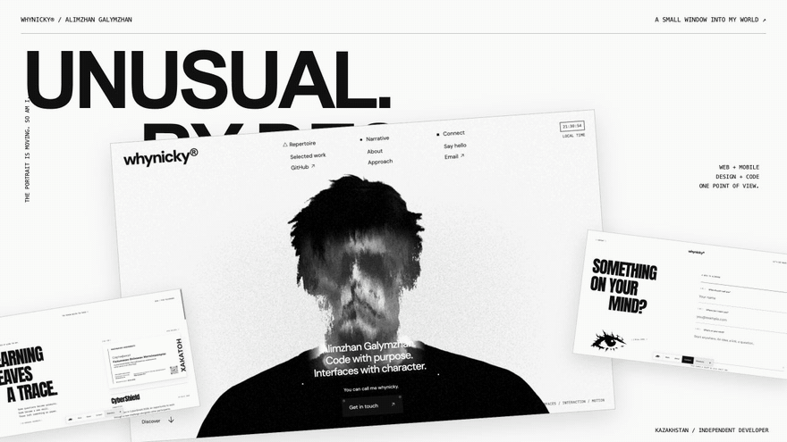

<br>

<p align="center">
  <picture>
    <source media="(prefers-color-scheme: dark)" srcset="./public/images/eye-mark-white.png">
    
  </picture>
</p>

<p align="center">
  <strong>FRONTEND,<br>BUT MAKE IT WEIRD.</strong>
</p>

<p align="center"><sub>ALIMZHAN GALYMZHAN / INDEPENDENT DEVELOPER / KAZAKHSTAN</sub></p>

<br>

<a href="https://whynicky.github.io/whynickyy/">
  
</a>

<p align="center">
  <a href="https://whynicky.github.io/whynickyy/"><strong>STEP INSIDE ↗</strong></a>
  &nbsp;&nbsp;/&nbsp;&nbsp;
  <a href="./public/documents/Alimzhan-Galymzhan-CV.pdf">RÉSUMÉ ↗</a>
  &nbsp;&nbsp;/&nbsp;&nbsp;
  <a href="mailto:alimzhanart@icloud.com">SAY HELLO ↗</a>
</p>

<br>

A personal portfolio for the things I build and the way I see them. Web and mobile interfaces, a living portrait, type in motion, and a collection of work that’s still growing.

**Off-white paper. Black ink. A little room for the unexpected.**

<br>

<p align="center">
  <a href="https://whynicky.github.io/whynickyy/#/work">01 / WORK</a>
  &nbsp;&nbsp;·&nbsp;&nbsp;
  <a href="https://whynicky.github.io/whynickyy/#/about">02 / ABOUT</a>
  &nbsp;&nbsp;·&nbsp;&nbsp;
  <a href="https://whynicky.github.io/whynickyy/#/process">03 / PROCESS</a>
  &nbsp;&nbsp;·&nbsp;&nbsp;
  <a href="https://whynicky.github.io/whynickyy/#/credentials">04 / CREDENTIALS</a>
  &nbsp;&nbsp;·&nbsp;&nbsp;
  <a href="https://whynicky.github.io/whynickyy/#/contact">05 / CONTACT</a>
</p>

<br>

---

<details>
<summary><strong>FOR THE CURIOUS / How it’s built ↗</strong></summary>

<br>

**Vite 7 / JavaScript / Three.js + GLSL / GSAP + ScrollTrigger / Lenis**

No component framework. The interface is rendered from JavaScript modules; CSS handles the editorial layouts. The portrait uses procedural displacement, monochrome lighting and tonal grain. The README animation is a recording of the site itself.

The work gallery supports pointer, touch and keyboard navigation. Original certificates open in a native dialog with arrow-key navigation and `Escape` to close. Contact prepares an email draft for the visitor to review and send.

Motion follows `prefers-reduced-motion` and the Directory switch. A static portrait appears when WebGL is unavailable; sound starts only after the visitor enables it.

#### Run it

Use **Node.js 22+** and npm.

```bash
git clone https://github.com/whynicky/whynickyy.git
cd whynickyy
npm ci
npm run dev
```

Open [127.0.0.1:5176](http://127.0.0.1:5176).

```bash
npm run build
npm run preview
```

Output: `dist/`. Preview: [127.0.0.1:4176](http://127.0.0.1:4176).

#### Find your way around

```text
src/
  main.js                 Routing, transitions and lifecycle
  studio-home.js          Homepage and scroll choreography
  studio-scene.js         WebGL portrait
  work-gallery.js         Interactive project gallery
  case-page.js            Project stories
  editorial-pages.js      About, Process, Credentials, Contact
  credential-archive.js   Original-document viewer
  contact-letter.js       Email draft preparation
  data.js                 Project content
  *.css                   Typography, layouts and responsive styles

public/
  images/                 Identity, portrait and fallbacks
  projects/               Project imagery
  certificates/           Original documents
  documents/              Résumé
  fonts/                  Local typefaces and licences
```

#### Publish it

Pushes to `main` run [the GitHub Pages workflow](./.github/workflows/pages.yml): install with Node 22, build with the repository base path, and deploy `dist/`.

To check that base path locally:

```bash
DEPLOY_BASE=/whynickyy/ npm run build
DEPLOY_BASE=/whynickyy/ npm run preview
```

Open [127.0.0.1:4176/whynickyy/](http://127.0.0.1:4176/whynickyy/).

</details>

<details>
<summary><strong>SMALL PRINT / Artwork & credits ↗</strong></summary>

<br>

- [Portrait artwork and implementation notes](./docs/HERO-ASSET.md)
- [Audio source and CC0 licence](./docs/AUDIO-LICENSE.md)
- [Typeface licences](./public/fonts)

The anonymous animated portrait is visual artwork, not a photograph of Alimzhan.

</details>

---

<p align="center">
  <sub>DESIGN AND CODE IN THE SAME CONVERSATION.</sub><br>
  <a href="https://github.com/whynicky">whynicky®</a> / 2026
</p>
