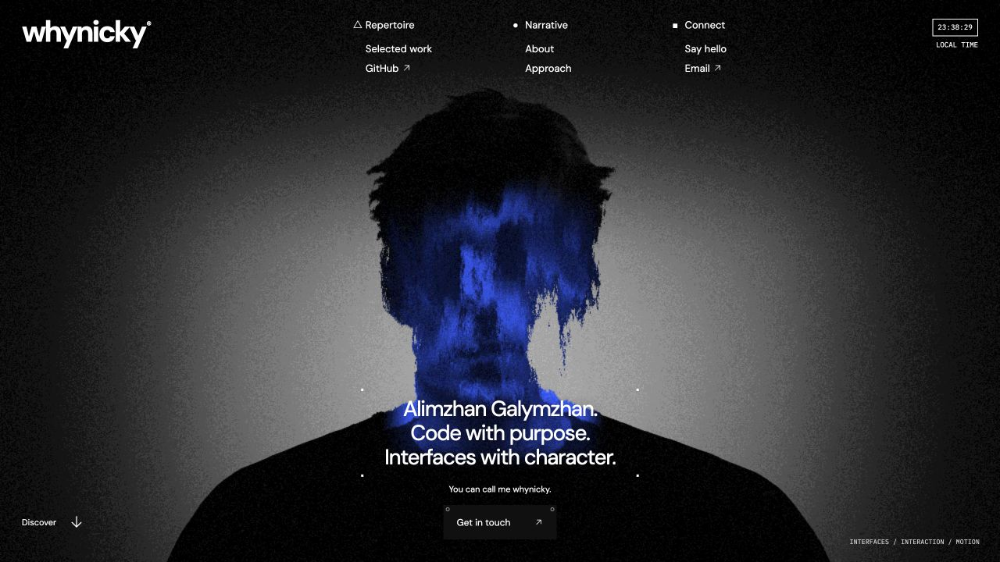

<p align="center">
  
</p>

<h1 align="center">whynicky®</h1>

<p align="center">
  Personal portfolio of Alimzhan Galymzhan.<br>
  Code with purpose. Interfaces with character.
</p>

<p align="center">
  <a href="https://whynicky.github.io/whynickyy/"><strong>View the live website ↗</strong></a>
  &nbsp;·&nbsp;
  <a href="./public/documents/Alimzhan-Galymzhan-CV.pdf">Résumé</a>
  &nbsp;·&nbsp;
  <a href="mailto:alimzhanart@icloud.com">Contact</a>
</p>

<p align="center">
  
  
  
  
</p>



## About

`whynicky®` is an editorial portfolio built to present selected web and mobile work without separating design from implementation. The site combines a grainy monochrome art direction with a Chrome Blue portrait treatment, restrained typography, tactile motion and project stories that remain readable on every screen.

The experience is intentionally framework-light: semantic HTML is rendered from JavaScript modules, motion is orchestrated with GSAP and Lenis, and the portrait is drawn in WebGL with Three.js.

## Highlights

- **Animated identity** — a custom WebGL portrait with procedural grain, blue tonal treatment, pointer depth and a static fallback.
- **Circular work gallery** — vertical, horizontal and grid layouts with wheel, drag, full-screen touch and keyboard navigation.
- **Editorial reading pages** — About, Process, Credentials and Contact use a quieter typographic system built for long-form content.
- **Project case studies** — responsive stories with role, stack, contribution, imagery and verified project links.
- **Considered motion** — route transitions, reveal sequences and an opening animation, with reduced-motion support throughout.
- **Accessible controls** — visible focus, native buttons and links, keyboard-operable dialogs, labelled regions and non-emoji SVG arrows.

## Pages

| Route | Purpose |
| --- | --- |
| `#/` | Animated introduction and personal positioning |
| `#/work` | Interactive selected-work gallery |
| `#/work/:project` | Individual project case study |
| `#/about` | Biography, experience and education |
| `#/process` | Six-stage working process and FAQ |
| `#/credentials` | Certificates and original documents |
| `#/contact` | Direct contact details and project enquiry guidance |

## Technology

| Layer | Tools |
| --- | --- |
| Build | Vite 7 |
| Interface | HTML, CSS, JavaScript ES modules |
| Motion | GSAP, ScrollTrigger, Lenis |
| Graphics | Three.js, GLSL, WebGL |
| Hosting | GitHub Pages, GitHub Actions |

No component framework or CSS library is used. Layout, navigation, animation and responsive behaviour are implemented specifically for this portfolio.

## Run locally

Requirements: Node.js 22 or newer and npm.

```bash
git clone https://github.com/whynicky/whynickyy.git
cd whynickyy
npm install
npm run dev
```

Open [http://127.0.0.1:5176](http://127.0.0.1:5176).

### Production build

```bash
npm run build
npm run preview
```

The production bundle is written to `dist/`; preview runs at [http://127.0.0.1:4176](http://127.0.0.1:4176).

## Project structure

```text
.
├── .github/workflows/pages.yml   # GitHub Pages deployment
├── docs/                         # Asset notes, licences and README preview
├── public/
│   ├── certificates/             # Original credentials
│   ├── documents/                # Résumé
│   ├── fonts/                    # Local typefaces and licences
│   ├── images/                   # Portrait source and fallbacks
│   └── projects/                 # Project imagery
├── src/
│   ├── main.js                   # Routing, transitions and shared lifecycle
│   ├── studio-home.js            # Homepage markup
│   ├── studio-scene.js           # Three.js portrait renderer
│   ├── work-gallery.js           # Interactive project gallery
│   ├── case-page.js              # Case-study renderer
│   ├── editorial-pages.js        # About, Process, Credentials, Contact
│   ├── data.js                   # Project content
│   └── *.css                     # Route and responsive styling
└── vite.config.js
```

## Interaction and accessibility

The gallery supports wheel, pointer, touchscreen and arrow-key input. Touch gestures are handled across the complete mobile gallery surface, while Grid mode returns to native page scrolling. Dialogs retain keyboard focus and close with `Escape`; sound is off by default and starts only after explicit interaction.

`prefers-reduced-motion` is respected, and visitors can also disable motion manually from Directory. When WebGL is unavailable, the homepage uses a static portrait composition instead of leaving an empty canvas.

## Deployment

Every push to `main` triggers [`.github/workflows/pages.yml`](./.github/workflows/pages.yml). GitHub Actions installs dependencies with Node 22, creates a Vite build using the repository name as the production base and deploys `dist/` to GitHub Pages.

To reproduce the Pages build locally:

```bash
DEPLOY_BASE=/whynickyy/ npm run build
DEPLOY_BASE=/whynickyy/ npm run preview
```

Then open [http://127.0.0.1:4176/whynickyy/](http://127.0.0.1:4176/whynickyy/).

## Assets and licences

- Portrait artwork and implementation notes: [`docs/HERO-ASSET.md`](./docs/HERO-ASSET.md)
- Audio source and CC0 licence: [`docs/AUDIO-LICENSE.md`](./docs/AUDIO-LICENSE.md)
- Font licences are stored beside the corresponding files in [`public/fonts`](./public/fonts)

The anonymous portrait is visual artwork and is not a photograph of Alimzhan.

---

<p align="center">
  Designed and developed by <a href="https://github.com/whynicky">Alimzhan Galymzhan</a> · 2026
</p>
